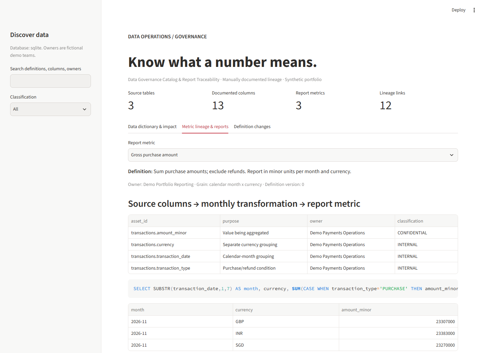

# Data Governance Catalog & Report Traceability

A searchable dictionary for a fictional card portfolio, with owners, sensitivity labels, documented report dependencies, executable sample metrics and versioned business-definition changes.

## Run locally

Python **3.13** is the tested version. Clone this repository and run these commands from its root:

```bash
git clone https://github.com/Abhijay-Nagal/governance-catalog.git
cd governance-catalog
python -m venv .venv
```

Activate the environment with `source .venv/bin/activate` on macOS/Linux or `.\.venv\Scripts\Activate.ps1` in Windows PowerShell, then:

```bash
python -m pip install -r requirements.txt
python -m streamlit run app.py
```

The app uses bundled **synthetic data** and an automatically created local SQLite database by default. No API key, cloud account, or other project repository is needed. Open the localhost URL printed by Streamlit.

For the command-line demonstration and exports:

```bash
python catalog.py
python catalog.py --help
```

`DATABASE_URL` selects an existing PostgreSQL database instead of the SQLite default. Use a `postgresql+psycopg://` connection URL stored in your environment; do not commit credentials. The code creates its own tables. Both backends are covered by the test suite.



## Tests

```bash
python -m pytest tests --import-mode=importlib -q
```

Tests use temporary SQLite databases unless `TEST_DATABASE_URL` selects a dedicated disposable PostgreSQL test database. Backend fixtures rebuild this project's tables in that test database. Never use a production or valuable database for tests. The dashboard interaction test always uses a temporary SQLite database.

GitHub Actions runs the suite on Python 3.13 with SQLite and PostgreSQL. The workflow also checks dependencies and exercises the standalone CLI.

## Deploy

The application entry point is **`app.py`**, and dependencies are in **`requirements.txt`**. See [deployment instructions](docs/DEPLOYMENT.md) for Streamlit Community Cloud and database persistence. Publishing this source repository does not itself create a running web app.

## What is included

- 3 conceptual source tables: customers, accounts, transactions.
- 13 documented columns with business definitions, types, fictional owners and PUBLIC/INTERNAL/CONFIDENTIAL sensitivity classifications.
- 3 monthly metrics: gross purchase amount, refund amount, net spend.
- 12 explicit column-to-metric dependency edges (4 per metric).
- Source-column impact lookup and SQL/source disclosure for each report.
- Before/after definition revisions with reviewer, reason, timestamp and version.
- Sample reports over a clean 3,000-transaction snapshot, grouped by calendar month AND currency.

## Architecture

Code-owned metadata registry + clean fixture -> idempotent seed -> relational assets/metrics/lineage tables -> search / direct impact / fixed SQL report -> optimistic versioned edits and change history.

`catalog.py` defines the schema and functions. `app.py` presents three tabs. SQL executes from a fixed code registry. The UI only edits description, owner and classification; executable metric logic stays in source control. A text definition edit does not change calculation logic. If the formula changes, update code, the stored SQL metadata and the documented metric version together; this initial project has no automatic schema/metric migration runner.

## Important semantics

Amounts are nonnegative integer minor units. Purchases add to gross spend, refunds have positive magnitudes, and net spend subtracts refunds. Reports keep INR, GBP and SGD separate. There is no FX table, conversion or combined-currency total. All four dependencies are explicit: amount, transaction type, transaction date and currency. Ownership is a fictional accountable team, not an access-control grant.

Lineage is manually maintained direct column-to-report lineage. No SQL parser, automatic discovery, graph traversal, column masking, permissions or retention enforcement is implemented. A column with no edges has no **documented** consumers; this does not establish that none exist. Sensitive-data labels describe intended handling and do not themselves hide data.

The catalog's clean fixture is independent of the quality monitor and reconciliation apps. Its reports are not automatically gated by another project's status. Logical source table names appear in metadata; the only physical report-data table in this standalone app is `gov_demo_transactions`.

## Changes and tests

An edit must include reviewer, reason, nonempty fields and the currently observed version. Update and history insertion are atomic. A stale version fails without adding history. Seeding again does not overwrite edits. Existing seeds are not an automatic migration mechanism.

Tests check complete registered dependencies, literal search, direct impact, revision preservation, stale updates, invalid edits, report arithmetic against an independent Python calculation, currency separation and dashboard interactions.

CLI exports: `artifacts/dictionary.csv` and `artifacts/summary.json`. See [the study guide](docs/STUDY_GUIDE.md).
